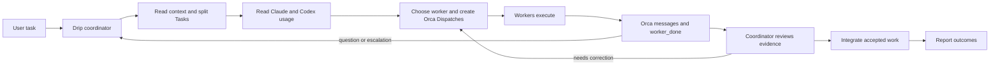
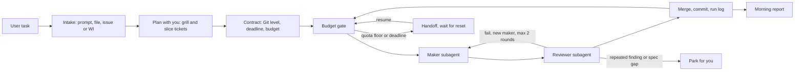

<p align="center">
  
</p>

# Robusta

Robusta is a collection of agent skills. **Drip** is the first skill: a coordinator for supervised worker agents using [Orca orchestration](https://www.onorca.dev/docs/cli/orchestration). **Pillow** is the second: an overnight runner that plans with you, then works alone through subagents of the same AI.

| Skill | What it does | Needs |
| --- | --- | --- |
| [Drip](#install-drip) | Supervised fan-out of Tasks to Claude or Codex workers, routed by remaining quota | Orca Desktop + CLI |
| [Pillow](#install-pillow) | Unattended night loop: tickets → maker → fresh reviewer → commit, parks decisions, waits out quota resets | Only the agent you already run |

## Install Drip

Prerequisites: Orca Desktop with its CLI available, orchestration enabled, and at least one agent CLI that Orca can launch. Current Orca builds can expose active-account usage through `orca account list --json`; older builds need another trustworthy usage source. Use `orca skills get orchestration` for your installed Orca's coordination guide.

Copy `skills/drip` into your agent's skill directory:

| Agent | Destination | Invocation |
| --- | --- | --- |
| Claude Code | `~/.claude/skills/drip/` | `/drip <task>` |
| Codex | `~/.codex/skills/drip/` | `$drip <task>` |

The destination must contain `SKILL.md` directly. Orca does not install Drip into the agent for you. Start a new agent session after copying if the skill does not appear immediately.

## How Drip works



1. **Scope:** Drip reads the request and repository rules, then writes self-contained Task specs with clear file ownership and observable acceptance.
2. **Route:** It reads account-matched usage, computes the lowest remaining percentage across applicable quota windows, reserves capacity for its coordinator, and chooses Claude or Codex for each Task. Unknown usage is never guessed.
3. **Dispatch:** It creates an Orca Run and starts the ready workers. Independent Tasks can run together; dependent Tasks wait for their prerequisites.
4. **Supervise:** It receives questions, escalations, and completion messages through Orca. A quiet terminal is not treated as a completed worker.
5. **Review:** It checks the real output against each Task spec and asks the owner to correct any gap.
6. **Integrate:** It applies accepted work under the repository's Git rules, settles worker terminals, and reports evidence and blockers.

Example request:

```text
/drip Split this feature into independent tasks, assign workers, review their results, and report blockers before integration.
```

Drip has no fixed model IDs, external quota-service dependency, or programming-language requirement. It reads the active account's Orca rate limits first; if no trustworthy usage source is available, it asks for the current numbers. It reads Orca's version-matched guide at the start of each run because the CLI may change.

## Install Pillow

Prerequisites: one agent CLI — Claude Code or Codex — that can spawn subagents and run shell commands. Git is optional (a plain folder works at `L0`). For `L3` or issue intake, `gh` or `az` must already be signed in; Pillow checks this before you leave and never changes settings itself.

Copy `skills/pillow` into your agent's skill directory:

| Agent | Destination | Invocation |
| --- | --- | --- |
| Claude Code | `~/.claude/skills/pillow/` | `/pillow <task>` · `/pillow resume <run-folder>` |
| Codex | `~/.codex/skills/pillow/` | `$pillow <task>` · `$pillow resume <run-folder>` |

The destination must contain `SKILL.md` directly. Start a new agent session after copying if the skill does not appear immediately. Optional: a `~/.pillow/models.md` file mapping the `fast` and `strong` tiers to the model ids and effort you allow; without it Pillow uses the agent's default model for every role and never a frontier-class model unless you name one.

## How Pillow works



An interactive version with guided views lives at [assets/pillow-workflow.html](assets/pillow-workflow.html).

1. **Intake:** Pillow reads the request in whatever form it arrives, fetches an issue or work item through `gh` or `az` when the Git remote says which host it is, and reads the repository's own rules so workers inherit them.
2. **Plan:** It interviews you one question at a time with a recommended answer, then slices the work into tracer-bullet tickets with blocking edges. Each ticket is the complete spec a worker receives: what to build, ownership, constraints, acceptance.
3. **Contract:** It asks the Git question every run — `L0` no commits, `L1` one local commit per reviewed ticket, `L2` push, `L3` draft PR — plus the deadline, the usage figure and the stop line it implies. Preflight runs the verify commands on the baseline and reports; it changes nothing. You approve before leaving.
4. **Night loop:** The main session stays a thin coordinator. A budget gate runs before every dispatch, keeping a 15-point reserve for the coordinator. Each ticket goes to a maker subagent, then to a fresh reviewer subagent that runs the build and tests itself and cites `file:line` for every finding.
5. **Anti-spiral:** A failed review gets a brand-new maker with only the findings, at most twice. A finding that repeats, or acceptance lines that cannot all be true, parks the ticket with the question for you — the attempt is saved as a patch, never looped on.
6. **Handoff and morning:** When quota or the deadline closes the gate, Pillow writes a handoff and waits for the reset if the agent can, or stops with resume instructions. The morning report fits on one screen: verified done, waiting for you, failed with patches, not started, and the first thing to do.

Example request:

```text
/pillow Port these four jobs, one commit each. I'm back at 8am.
```

Pillow has no Orca dependency, no second-provider requirement and no fixed model ids. Workers are subagents of the agent you are already running, so a machine with only Claude or only Codex works. Usage numbers you state win over any tool reading; unknown usage is never guessed.
