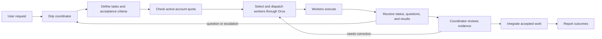
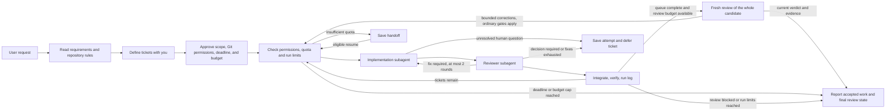

<p align="center">
  
</p>

# Robusta

Robusta is an installable plugin that bundles Drip and Pillow for coordinating engineering work with Claude Code and Codex. The skills run within your agent session and use its available tools and permissions.

| Skill | Purpose | Requirements |
| --- | --- | --- |
| [Drip](#drip-requirements) | Coordinate supervised work across Claude and Codex workers, selecting a provider based on available quota | Orca Desktop, its CLI, and at least one supported agent CLI |
| [Pillow](#pillow-requirements) | Execute an approved work queue while you are away, with separate implementation and review steps | Claude Code or Codex with subagent and shell support |

## Install

Install `robusta` once to get both skills. The commands below use the marketplace published from this repository; the plugin manifests and catalogs must be pushed to GitHub before remote installation works.

### Claude Code

Run inside Claude Code:

```text
/plugin marketplace add encryptedarc/robusta
/plugin install robusta@robusta
```

Or run from a terminal:

```sh
claude plugin marketplace add encryptedarc/robusta
claude plugin install robusta@robusta
```

### Codex

Run from a terminal with a Codex CLI that provides `codex plugin`:

```sh
codex plugin marketplace add encryptedarc/robusta
codex plugin add robusta@robusta
```

In Codex Desktop, the registered marketplace is also available in the plugin browser. Start a new session after installation; restart the desktop app if the marketplace is not shown.

### Invoke the skills

| Agent | Drip | Pillow | Resume Pillow |
| --- | --- | --- | --- |
| Claude Code | `/robusta:drip <task>` | `/robusta:pillow <task>` | `/robusta:pillow resume <run-folder>` |
| Codex | `$drip <task>` | `$pillow <task>` | `$pillow resume <run-folder>` |

If you previously copied these skills into your agent's skills directory, remove the old copies after verifying the plugin installation to avoid loading duplicate skills. For plugin installations, use the invocation above wherever a skill's instructions show the standalone `/pillow` shorthand.

### Test from a local checkout

From the repository root, use a local marketplace instead of GitHub:

```sh
claude plugin validate .
claude plugin marketplace add .
claude plugin install robusta@robusta
```

```sh
codex plugin marketplace add .
codex plugin add robusta@robusta
```

Use either the local or GitHub source for the `robusta` marketplace in each agent. Local installation is useful for testing changes before pushing them.

The [Claude Code marketplace guide](https://code.claude.com/docs/en/plugin-marketplaces) and [OpenAI plugin packaging guide](https://developers.openai.com/plugins/build/plugins) describe the supported layouts. Both manifests load the same `skills/` directory, including each skill's reference files.

## Drip requirements

You need Orca Desktop with orchestration enabled, its CLI available, and at least one Claude Code or Codex CLI that Orca can launch.

Drip reads the installed Orca CLI's coordination guide at the start of each run. With the standard `orca` executable, you can inspect that guide using `orca skills get orchestration`. For quota data, Drip uses `orca account list --json` when the installed CLI supports it; otherwise it needs another trustworthy source or figures you provide.

## How Drip works



1. **Define the work.** Read the request and repository rules, then create tasks with file ownership, dependencies, and verifiable acceptance criteria.
2. **Select workers.** Check quota for the active accounts, reserve capacity for the coordinator, and choose Claude or Codex within your provider and model preferences.
3. **Dispatch and supervise.** Start independent tasks concurrently through Orca. Track completion, handle worker questions, and ask you to resolve decisions outside the approved scope.
4. **Review results.** Check the actual files and outputs against each task's acceptance criteria, and return incomplete work to its owner.
5. **Integrate and report.** Apply accepted changes under the repository's Git and approval rules, complete worker cleanup, and report verified results and unresolved blockers.

Example request:

```text
/robusta:drip Add CSV export to the orders page. Split independent work across available workers, verify the results, and report blockers before integration.
```

For detailed instructions, see the [Drip skill](skills/drip/SKILL.md) and [quota routing policy](skills/drip/references/usage-routing.md).

## Pillow requirements

You need Claude Code or Codex with permission to create subagents and run shell commands. Pillow uses subagents from the same provider as the coordinating session. Git is required for commits, pushes, and pull requests; a plain folder is supported at level `L0`.

GitHub issue access and draft pull requests require an authenticated `gh` CLI. Azure DevOps work items and draft pull requests require an authenticated `az` CLI with the relevant commands available.

Optional model configuration belongs in `~/.pillow/models.md`, which maps the `fast` and `strong` tiers to model IDs and effort settings. Without that file, Pillow uses the agent's configured defaults. Model choices are confirmed as part of run approval; see the [model and budget policy](skills/pillow/references/routing.md).

### Unattended permissions on each machine

Pillow is a skill, not a permission manager. Git levels authorize work but do not approve shell commands. Before first dispatch and every resume, Pillow requires current-host evidence that coordinator and workers reject unapproved actions without waiting for a person, plus permission coverage for the planned commands and paths. A successful build/test or `acceptEdits` alone is insufficient.

For Claude Code, configure narrowly scoped allow rules through `/permissions` and use a host-supported no-prompt rejection policy such as `dontAsk`; check the actual worker policies too. For Codex, check the effective approval policy and sandbox/path access through the installed host's controls. Permission and command syntax vary by host/version: Pillow reports missing setup for you to configure and never changes settings, hooks or credentials itself. See [permission preflight and recovery](skills/pillow/references/permissions.md) for the evidence required.

For CLI hosts that advertise these flags in `--help`, start the session yourself from the intended project folder, then invoke Pillow:

| Host | Example session command |
| --- | --- |
| Claude Code | `claude --permission-mode dontAsk` (configure the required narrow allow rules first) |
| Codex | `codex --sandbox workspace-write --ask-for-approval never` |

These commands select rejection rather than human prompts; they do not grant missing command/path access. Desktop and remote hosts may expose different controls. See [Claude Code permissions](https://code.claude.com/docs/en/permissions) and [Codex sandboxing and approvals](https://learn.chatgpt.com/docs/sandboxing).

Returned permission denials park the ticket with `blocked_permission` without a code-fix round. Independent work continues only after verified recovery and its own permission gate. If recovery or integration is blocked, Pillow preserves the attempt and stops dispatch. A pending host approval dialog can still block a live worker; skill text cannot dismiss it. On another machine, permission readiness is checked again while retaining the approved scope and Git level.

These changes apply when the updated plugin is loaded in a new session. Existing sessions and older installed copies do not gain new instructions automatically; publish and update the plugin through your host's plugin manager before using it on other machines.

## How Pillow works



An [interactive workflow diagram](assets/pillow-workflow.html) is also available.

1. **Read requirements.** Accept a prompt, file, issue, or work item, and read the repository rules that apply to the work.
2. **Define tickets.** Clarify scope with you and divide the request into small, independently verifiable changes. Each ticket specifies the behavior to implement, permitted files, constraints, dependencies, and acceptance criteria. Map each decision to the affected paths, including absent inputs and legacy data; a conflict with earlier scope waits for your answer.
3. **Approve the run.** Record the tickets, Git permissions, deadline, usage budget, model choices, loaded skill revision, and decisions that require your input. Save the whole-run review scope and baseline, and budget its reviewer within the run limits. Run baseline verification and check tool access before you leave. The host must remain awake and online for unattended execution.
4. **Implement and review.** Assign each ticket to an implementation subagent, then a separate reviewer that runs verification itself. Record every human question and its approved answer or unresolved status before integration; a code PASS does not answer it. Recheck the combined result before marking a ticket complete or pushing changes. Reviewers verify brief premises from source and trace remaining failure paths when writes move.
5. **Handle failures.** Allow at most two correction rounds with new implementation and review subagents. Defer unresolved decisions or repeated failures, save a recoverable attempt, and restore the pre-ticket state while preserving earlier accepted work.
6. **Review the whole candidate and report.** A fresh reviewer from the same provider checks the cumulative diff and interactions between tickets. Its verdict is tied to the actual base, candidate contents and approved decisions; later changes require another review. L0 and plain folders use snapshots/manifests, including untracked and binary changes. Accepted tickets remain recorded when final review is pending, blocked or finds issues. Whole-goal completion requires the approved scope done, resolved decisions, combined verification and current final PASS. On resume, reconcile those identities before reusing evidence.

### Git permissions

Choose a level for each new run:

| Level | Authorized actions |
| --- | --- |
| `L0` | Leave reviewed changes in the working folder without commits; execute tickets sequentially |
| `L1` | Create local commits for reviewed tickets |
| `L2` | `L1` plus push the approved branch |
| `L3` | `L2` plus open a draft pull request |

Pillow does not merge pull requests, force-push, or change issue and work-item states. Run approval records the scope and permissions that apply while you are away.

### Quota and resume

Pillow checks quota before starting work and tracks a per-run usage cap against an agreed quota window. Quota resets do not replenish that cap. The review reserve can finish the required whole-run review at ≥15% and <30% remaining when time and cap permit, but cannot start a correction maker below 30%; below 15% dispatch stops. When a usage tool is available, Pillow refreshes its readings; otherwise it starts from figures you provide and estimates subsequent consumption.

Automatic continuation after a quota reset requires a scheduling capability in the host environment, a reset before the approved deadline, and remaining run budget. If automatic continuation is unavailable, Pillow saves a handoff; eligible runs can be resumed manually using the commands above. Reaching the deadline or usage cap ends the run.

The [routing policy](skills/pillow/references/routing.md) defines quota thresholds and reset accounting. The [run log reference](skills/pillow/references/runlog.md) describes handoff and report files.

Example request:

```text
/robusta:pillow Add slugify(text) and a CLI command that uses it, with tests for both. Use L1 with no push. Stop by 08:00 tomorrow and defer any change to existing CLI output for my review.
```

Pillow will confirm the remaining run details before starting. For the full procedure, see the [Pillow skill](skills/pillow/SKILL.md).

## Acknowledgements

Pillow's requirements interview and ticket-planning workflow were inspired by Matt Pocock's [grill-me](https://github.com/mattpocock/skills/tree/main/skills/productivity/grill-me) and [to-tickets](https://github.com/mattpocock/skills/tree/main/skills/engineering/to-tickets) skills.
